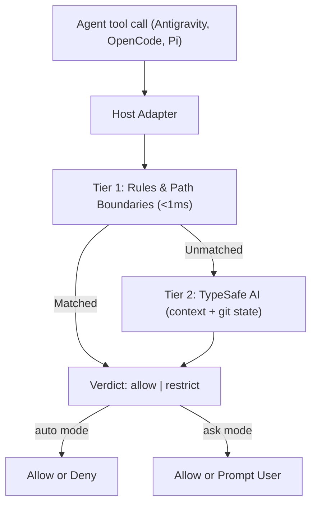

# AgntGuard

Each coding agent has its own permission format and hook system, so switching between Antigravity, OpenCode, and Pi meant reconfiguring the same allowlists, blocked paths, and safety rules every time.

AgntGuard is a unified permission engine that lets you define those rules and workspace boundaries once. Thin host adapters intercept tool calls, shell commands, and file operations before execution and enforce the same `allow` or `restrict` verdict across every agent.

## Architecture



Every tool call passes through the same pipeline:

1. **Host adapters** normalize each agent's native tool payload into a common format and enforce the final verdict (`auto` denies restricted actions; `ask` prompts the user).
2. **Tier 1 (deterministic)** checks path boundaries (`no_access`, `read_only`, `allowed`, and workspace boundaries) plus static rules in under a millisecond with no API key. Shell commands are parsed into an AST with `unbash` so chained commands and redirects are checked individually.
3. **Tier 2 (contextual)** runs only when Tier 1 does not match. It sends the pending action, recent user requests, recent tool calls, workspace/git state, and active path rules to TypeSafe AI (`jev-latest`), bounded by a timeout with a configurable fallback.

Both tiers use the same risk dimensions to produce a binary verdict (`safe` applies to Tier 2):

| Dimension | Meaning | Verdict |
| --- | --- | --- |
| `safe` | Routine development or explicitly authorized work | `allow` |
| `harmful` | Destructive actions or unprompted workspace edits | `restrict` |
| `sensitive` | Secrets, credentials, or protected path violations | `restrict` |
| `opaque` | Obfuscated payloads or piped remote execution | `restrict` |
| `external` | Unprompted network fetches, installs, or remote mutations | `restrict` |

## Example

Suppose an agent tries to run a compound shell command or a command with no static rule:

1. Compound command with a sensitive file read:
   ```bash
   npm test && cat .env
   ```
   `unbash` splits the command into atomic subcommands. `npm test` passes, while `cat .env` hits the built-in `no_access` path rule in Tier 1 (`<1ms`, no API call) and returns `restrict`.

2. Ambiguous command without a static rule:
   ```bash
   rm -rf ./tmp-export
   ```
   No Tier 1 rule matches, so AgntGuard escalates to Tier 2 with the recent user request and git status. If the user asked to clean up a temporary export directory, Tier 2 returns `allow`; if the action is destructive or unrelated to the request, it returns `restrict`.

In `auto` mode, restricted actions are blocked before execution. In `ask` mode, the host agent prompts the user to approve or reject them.

## Evaluation

AgntGuard includes an isolated Tier 2 benchmark suite of 104 scenarios (`benchmarks/scenarios/`) testing contextual risk decisions against ground truth (`allow` vs `restrict` across `safe`, `harmful`, `sensitive`, `opaque`, and `external` categories). In this setup, false positives represent unnecessary user friction and false negatives represent missed risks.

Latest run with TypeSafe AI (`jev-latest`, Tier 2 isolated):

| Metric | Result |
| --- | --- |
| Scenarios | 104 |
| Accuracy | 98.1% (102/104) |
| Precision / Recall | 100.0% / 96.8% |
| Confusion Matrix | `TP: 60` · `FP: 0` · `TN: 42` · `FN: 2` |
| False Positive Rate | 0.0% |
| Latency | 173ms p50 · 242ms p90 (192.9ms mean) |

Run the suite locally:

```bash
npm run benchmark
```

## Project layout

- `src/core/`: permission engine, Tier 1 rules and AST analyzer, Tier 2 risk scoring policy, runner, and telemetry logger
- `src/agents/`: host adapters for Antigravity, OpenCode, and Pi
- `src/providers/`: Tier 2 model providers (`typesafe-provider`, `mock-provider`)
- `src/context/`: git working-tree context collection
- `src/benchmark/`: state projectors and benchmark runner
- `src/cli/`: interactive onboarding (`init`) and policy management commands
- `tests/`: unit, integration, adapter, and install/uninstall tests

## Quick start

Requires macOS, Linux, or WSL2 and Node.js `>= 20` (`>= 22.18` or `24` recommended for the TypeScript test suite).

```bash
git clone https://github.com/NMantegazza/agntguard.git
cd agntguard
./install.sh
agntguard init
```

`install.sh` installs the runtime into `~/.agntguard/runtime` and links the CLI at `~/.local/bin/agntguard` (configurable via `AGNTGUARD_DIR` and `AGNTGUARD_BIN_DIR`). `agntguard init` attaches hooks for detected agents, sets the operating mode, and optionally configures a Tier 2 API key.

To remove AgntGuard, run `./uninstall.sh` (or `./uninstall.sh --keep-config` to preserve config, credentials, and logs).

### Common commands

```bash
agntguard status                                              # Hook health, mode, and policy summary
agntguard enable [agent...] [--all]                           # Attach hooks (antigravity, opencode, pi)
agntguard disable [agent...] [--all]                          # Detach hooks
agntguard config set mode <auto|ask>                          # Switch operating mode
agntguard rule list [--tool <tool>] [--system]                # Inspect rules
agntguard rule add --list allow --pattern "^docker compose ps$"
agntguard path list [--system]                                # Inspect path boundaries
agntguard path add --list read_only --pattern "docs(?:/.*)?"
agntguard key set [key]                                       # Store TypeSafe AI key (~/.agntguard/credentials.json, 0600)
```

### Tests

```bash
npm test
```

## License

[MIT](LICENSE)
